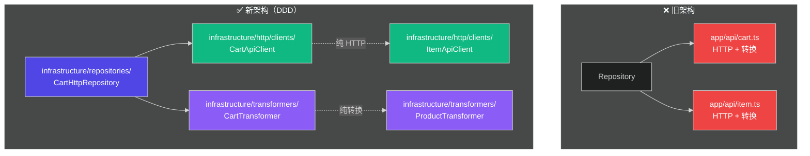
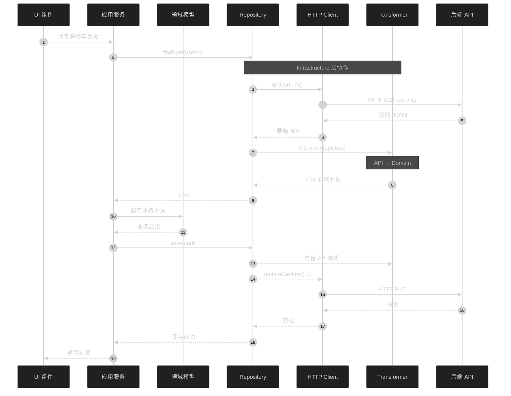

# API 层迁移到 Infrastructure 层总结

## 📋 迁移概述

将原来独立的 `app/api/` 层重构为符合 DDD 架构的 `infrastructure/http/` 层，职责更清晰，架构更合理。

**迁移时间**: 2025-01-09
**影响范围**: API 调用、数据转换、仓储实现

## 🎯 迁移目标

### 1. 解决的问题

| 问题 | 原因 | 解决方案 |
|------|------|----------|
| **职责混乱** | `app/api/` 既做 HTTP 调用又做数据转换 | 拆分为 HTTP Client + Transformer |
| **层级不清晰** | API 层独立存在，不符合 DDD | 归入 Infrastructure 层 |
| **代码重复** | Repository 和 API 层功能重叠 | 统一使用 HTTP Client |
| **难以测试** | HTTP 调用和业务逻辑耦合 | 纯函数转换器，易于测试 |

### 2. 架构优化



## 📁 新的目录结构

```
app/
├── infrastructure/                    ⭐ 基础设施层
│   ├── http/                         ⭐ 新增：HTTP 相关
│   │   ├── clients/                  # HTTP 客户端
│   │   │   ├── CartApiClient.ts      # 购物车 HTTP 客户端
│   │   │   ├── ItemApiClient.ts      # 商品 HTTP 客户端
│   │   │   └── index.ts              # 统一导出
│   │   └── index.ts
│   │
│   ├── repositories/                 # 仓储实现
│   │   └── CartHttpRepository.ts     # 使用 CartApiClient
│   │
│   └── transformers/                 # 数据转换器
│       ├── cartTransformer.ts        # 购物车数据转换
│       └── productTransformer.ts     # 商品数据转换
│
├── api/                              ✅ 保留作为 Facade 层
│   ├── item.ts                       # 使用 ItemApiClient + ProductTransformer
│   └── index.ts                      # 统一导出
│
└── (删除) api/cart.ts               ❌ 已删除（由 CartApiClient 替代）
```

## 🔄 职责划分

### 1. HTTP Client 层 (`infrastructure/http/clients/`)

**职责**：
- ✅ 封装 HTTP 请求
- ✅ 处理网络通信
- ✅ 返回原始 API 响应
- ❌ 不包含业务逻辑
- ❌ 不包含数据转换

**示例**：

```typescript
// app/infrastructure/http/clients/CartApiClient.ts
export class CartApiClient {
  private get http() {
    return useHttpMethods()
  }

  /**
   * 获取购物车列表
   * 只负责 HTTP 调用，返回原始响应
   */
  async getCartList(): Promise<any> {
    return this.http.get('/cart/list', {
      server: false,
      cache: 'default',
      key: 'cart-list',
    })
  }

  async addToCart(params: IAddCartRequest) { ... }
  async updateCartItem(itemId: string, params: IUpdateCartRequest) { ... }
  async removeCartItem(itemId: string) { ... }
  async clearCart() { ... }
}

export const cartApiClient = new CartApiClient()
```

### 2. Transformer 层 (`infrastructure/transformers/`)

**职责**：
- ✅ API 响应 → 领域模型
- ✅ 领域模型 → UI 数据
- ✅ 领域模型 → API 请求
- ✅ 纯函数实现
- ❌ 不包含 HTTP 调用

**示例**：

```typescript
// app/infrastructure/transformers/cartTransformer.ts
export class CartTransformer {
  /**
   * API 响应转换为领域模型
   */
  static toDomain(userId: string, apiItems: ICartItem[]): Cart {
    const items = apiItems.map(apiItem => {
      return new CartItemEntity({
        id: apiItem.id,
        productId: apiItem.product_id,
        price: apiItem.price,
        quantity: apiItem.quantity,
      })
    })
    return new Cart(userId, items)
  }

  /**
   * 领域模型转换为 UI 数据
   */
  static toUIModel(item: CartItemEntity): ICartItem {
    return {
      id: item.id,
      product_id: item.productId,
      price: item.price.amount,
      quantity: item.quantity.value,
    }
  }
}
```

### 3. Repository 层 (`infrastructure/repositories/`)

**职责**：
- ✅ 实现领域层定义的接口
- ✅ 使用 HTTP Client 获取数据
- ✅ 使用 Transformer 转换数据
- ✅ 管理缓存策略
- ✅ 处理持久化逻辑

**示例**：

```typescript
// app/infrastructure/repositories/CartHttpRepository.ts
import { cartApiClient } from '~/infrastructure/http/clients/CartApiClient'
import { CartTransformer } from '~/infrastructure/transformers/cartTransformer'

export class CartHttpRepository implements ICartRepository {
  async findById(cartId: string): Promise<Cart | null> {
    // 1. 检查缓存
    const cached = this.loadFromCache(cartId)
    if (cached) return cached

    // 2. 使用 HTTP Client 获取数据
    const { data } = await cartApiClient.getCartList()
    if (!data || !data.cart) return null

    // 3. 使用 Transformer 转换为领域模型
    const cart = CartTransformer.toDomain(cartId, data.cart.items || [])

    // 4. 保存缓存
    this.saveToCache(cartId, cart)

    return cart
  }

  async save(cart: Cart): Promise<void> {
    const updatePromises = cart.items.map((item) => {
      return cartApiClient.updateCartItem(item.id, {
        quantity: item.quantity.value,
        selected: item.selected,
      })
    })
    await Promise.all(updatePromises)
    this.saveToCache(cart.id, cart)
  }
}
```

### 4. API Facade 层 (`app/api/`)

**职责**：
- ✅ 为上层提供统一的 API 访问接口
- ✅ 组合 HTTP Client + Transformer
- ✅ 简化上层调用

**示例**：

```typescript
// app/api/item.ts
import { itemApiClient } from '~/infrastructure/http/clients/ItemApiClient'
import { ProductTransformer } from '~/infrastructure/transformers/productTransformer'

class ItemApi {
  async getProductList(params: IItemListParams) {
    // 使用 HTTP Client 获取原始数据
    const response = await itemApiClient.getItemList(params)
    
    if (response?.data?.list) {
      // 使用 Transformer 转换为 UI 数据
      const uiList = ProductTransformer.toUIList(response.data.list)
      return { data: { list: uiList, total_count: response.data.total_count } }
    }
    
    return { data: { list: [], total_count: 0 } }
  }
}

export const itemApi = new ItemApi()
```

## 📝 迁移步骤

### Step 1: 创建 HTTP Client

- ✅ 创建 `infrastructure/http/clients/CartApiClient.ts`
- ✅ 创建 `infrastructure/http/clients/ItemApiClient.ts`
- ✅ 创建统一导出文件 `infrastructure/http/clients/index.ts`

### Step 2: 更新 Repository

- ✅ 更新 `CartHttpRepository.ts` 使用 `cartApiClient`
- ✅ 移除对 `app/api/cart` 的依赖

### Step 3: 更新 API Facade

- ✅ 更新 `app/api/item.ts` 使用 `itemApiClient`
- ✅ 更新 `app/api/index.ts` 移除 `cartApi` 引用

### Step 4: 清理旧代码

- ✅ 删除 `app/api/cart.ts`（290 行）
- ✅ 验证所有 Linter 错误已修复

## 🔍 完整的数据流



## ✅ 迁移结果

### 1. 文件变更

| 操作 | 文件 | 说明 |
|------|------|------|
| ✅ **新增** | `infrastructure/http/clients/CartApiClient.ts` | 购物车 HTTP 客户端（209 行） |
| ✅ **新增** | `infrastructure/http/clients/ItemApiClient.ts` | 商品 HTTP 客户端（126 行） |
| ✅ **新增** | `infrastructure/http/clients/index.ts` | 统一导出 |
| ✅ **新增** | `infrastructure/http/index.ts` | HTTP 层入口 |
| ✅ **修改** | `infrastructure/repositories/CartHttpRepository.ts` | 使用 CartApiClient |
| ✅ **修改** | `api/item.ts` | 使用 ItemApiClient + Transformer |
| ✅ **修改** | `api/index.ts` | 移除 cartApi 引用 |
| ❌ **删除** | `api/cart.ts` | 已由 CartApiClient 替代 |

### 2. 代码统计

| 指标 | 变化 |
|------|------|
| **新增代码** | +335 行（HTTP Clients） |
| **删除代码** | -290 行（旧 cart.ts） |
| **净增加** | +45 行 |
| **职责分离** | HTTP 调用 / 数据转换 / 业务逻辑 |
| **Linter 错误** | 0 个 ✅ |

### 3. 架构改进

| 改进点 | 说明 |
|--------|------|
| ✅ **符合 DDD** | Infrastructure 层职责清晰 |
| ✅ **单一职责** | HTTP Client / Transformer / Repository 各司其职 |
| ✅ **易于测试** | 纯函数转换器，易于单元测试 |
| ✅ **可替换性** | HTTP Client 可轻松替换为其他实现 |
| ✅ **类型安全** | 完整的 TypeScript 类型定义 |

## 🎯 使用指南

### 在 Repository 中使用

```typescript
import { cartApiClient } from '~/infrastructure/http/clients/CartApiClient'
import { CartTransformer } from '~/infrastructure/transformers/cartTransformer'

class SomeRepository {
  async getData() {
    // 1. 使用 HTTP Client 获取数据
    const response = await cartApiClient.getCartList()
    
    // 2. 使用 Transformer 转换数据
    const cart = CartTransformer.toDomain(userId, response.data.items)
    
    return cart
  }
}
```

### 在页面中使用（通过 Facade）

```typescript
import { api } from '~/api'

// 获取商品列表
const { data } = await api.item.getProductList({
  page: '1',
  pageSize: '20'
})
```

### 直接使用 HTTP Client（不推荐）

```typescript
import { itemApiClient } from '~/infrastructure/http/clients'

// 仅在需要原始 API 响应时使用
const response = await itemApiClient.getItemList(params)
```

## 🚀 后续优化建议

### 1. 添加请求/响应拦截器

```typescript
// app/infrastructure/http/interceptors/authInterceptor.ts
export class AuthInterceptor {
  request(config) {
    // 添加 token
    config.headers.Authorization = `Bearer ${getToken()}`
    return config
  }
  
  response(response) {
    // 处理响应
    return response
  }
}
```

### 2. 统一错误处理

```typescript
// app/infrastructure/http/interceptors/errorInterceptor.ts
export class ErrorInterceptor {
  response(error) {
    if (error.status === 401) {
      // 跳转到登录页
      navigateTo('/login')
    }
    throw error
  }
}
```

### 3. 添加请求重试

```typescript
// app/infrastructure/http/interceptors/retryInterceptor.ts
export class RetryInterceptor {
  async request(config) {
    const maxRetries = 3
    // 实现重试逻辑
  }
}
```

### 4. 完善类型定义

```typescript
// 为所有 API 响应定义精确的类型
interface CartListResponse {
  data: {
    cart: {
      items: ICartItem[]
      total_count: number
      // ...
    }
  }
}

async getCartList(): Promise<CartListResponse> {
  return this.http.get('/cart/list', { ... })
}
```

## 📚 相关文档

- [DDD 开发指南](./DDD-DEVELOPMENT-GUIDE.md)
- [购物车 DDD 实现总结](./shopping-cart-ddd-implementation-summary.md)
- [Entities 迁移到 Transformers 总结](./entities-to-transformers-migration.md)

## 🎉 总结

这次 API 层迁移完成了以下目标：

1. ✅ **职责分离**：HTTP 调用、数据转换、业务逻辑完全分离
2. ✅ **符合 DDD**：Infrastructure 层职责清晰，符合 DDD 架构
3. ✅ **易于测试**：纯函数转换器，HTTP Client 可 mock
4. ✅ **可维护性**：代码结构清晰，易于理解和维护
5. ✅ **可扩展性**：易于添加拦截器、重试等功能

**Infrastructure 层现在是项目中技术实现的核心，处理所有与外部系统的交互！** 🚀

