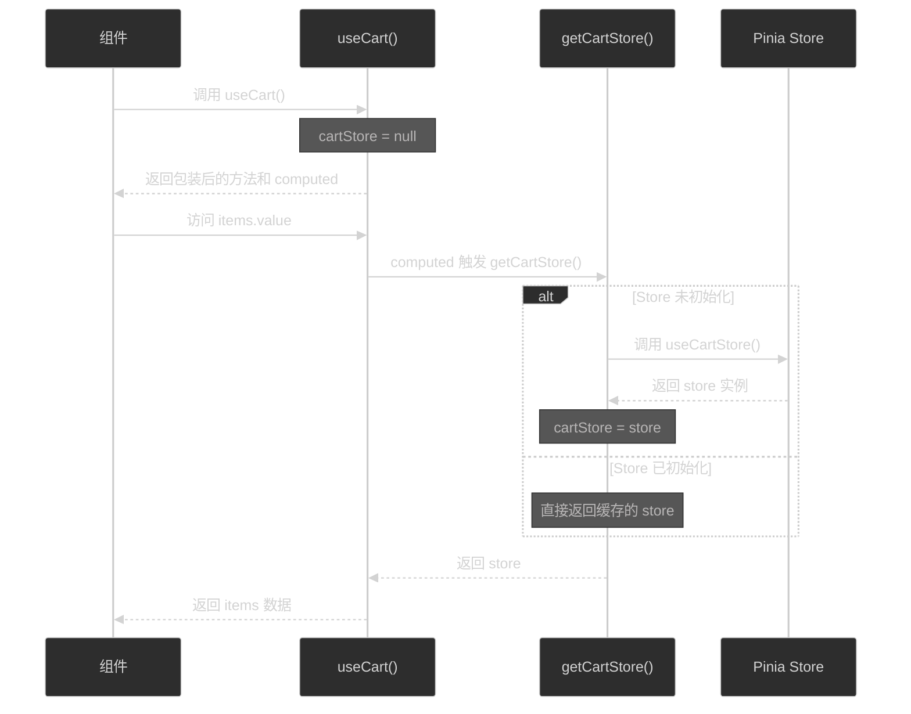

# Pinia SSR 初始化问题修复文档

## 📋 问题描述

在运行 Nuxt 应用时，遇到以下错误：

```
[🍍]: "getActivePinia()" was called but there was no active Pinia. 
Are you trying to use a store before calling "app.use(pinia)"?
```

### 错误原因

在 SSR（服务端渲染）环境下，当组件在 `<script setup>` 顶层直接调用 `useCartStore()` 时，Pinia 可能还没有完成初始化，导致报错。

### 问题定位

以下文件在顶层直接调用了 store：

```vue
<!-- app/components/SpProductCard/main.vue -->
<script setup>
const { addToCart, isAdding } = useCart()  // 立即调用
</script>
```

```vue
<!-- app/pages/cart/index.vue -->
<script setup>
const { ... } = useCart()  // 立即调用
</script>
```

而 `useCart()` composable 内部会立即调用 `useCartStore()`：

```typescript
// 修改前的代码
export function useCart() {
  const cartStore = useCartStore()  // ❌ 立即调用，SSR 时可能出错
  const { items, loading, ... } = storeToRefs(cartStore)
  // ...
}
```

## 🔧 解决方案

### 方案：延迟初始化 Store（懒加载模式）

通过**延迟初始化 + Computed 属性**的方式，确保 store 只在实际使用时才被创建。

#### 修改前后对比

**修改前：**
```typescript
export function useCart() {
  const cartStore = useCartStore()  // ❌ 立即调用
  const { items, loading, cartCount } = storeToRefs(cartStore)
  
  return { items, loading, cartCount, ... }
}
```

**修改后：**
```typescript
export function useCart() {
  // 延迟初始化 store
  let cartStore: ReturnType<typeof useCartStore> | null = null
  
  // 懒加载获取 store 实例
  const getCartStore = () => {
    if (!cartStore) {
      cartStore = useCartStore()  // ✅ 仅在首次使用时初始化
    }
    return cartStore
  }
  
  // 使用 computed 延迟获取状态
  const items = computed(() => getCartStore().items)
  const loading = computed(() => getCartStore().loading)
  const cartCount = computed(() => getCartStore().cartCount)
  
  return { items, loading, cartCount, ... }
}
```

### 核心改进点

1. **延迟初始化**：store 实例只在首次访问时创建
2. **Computed 包装**：所有状态通过 computed 包装，确保响应式
3. **单例模式**：同一个 `useCart()` 调用中，store 实例只创建一次
4. **SSR 兼容**：不会在服务端渲染时过早调用 Pinia

## 📊 工作原理图



## ✅ 验证方法

### 1. 检查控制台
启动开发服务器，不应再看到 Pinia 错误：

```bash
pnpm dev
```

预期输出：
```
✅ ECSHOPX v1.0.0 已启动
✓ Nuxt DevTools is enabled
```

### 2. 测试场景

| 场景 | 预期结果 |
|------|---------|
| 访问首页 | ✅ 不报错，商品卡片正常显示 |
| 访问购物车页面 | ✅ 不报错，购物车正常加载 |
| 添加商品到购物车 | ✅ 功能正常，数量显示正确 |
| SSR 渲染页面 | ✅ 服务端渲染成功，无 Pinia 错误 |

## 📝 关键代码片段

### useCart.ts 核心实现

```typescript
export function useCart() {
  // 延迟初始化
  let cartStore: ReturnType<typeof useCartStore> | null = null
  
  const getCartStore = () => {
    if (!cartStore) {
      cartStore = useCartStore()
    }
    return cartStore
  }
  
  // Computed 包装状态
  const items = computed(() => getCartStore().items)
  const cartCount = computed(() => getCartStore().cartCount)
  
  // 方法包装
  const addToCart = async (params: IAddCartRequest) => {
    return await getCartStore().addToCart(params)
  }
  
  return {
    get cartStore() {
      return getCartStore()  // 支持直接访问 store
    },
    items,
    cartCount,
    addToCart,
    // ...
  }
}
```

## 🎯 最佳实践建议

### 1. Composable 设计原则

在 Nuxt 项目中，编写 composable 时应遵循：

✅ **推荐做法**
```typescript
export function useMyStore() {
  // 延迟初始化
  const getStore = () => useXxxStore()
  
  // 使用 computed 包装
  const data = computed(() => getStore().data)
  
  return { data }
}
```

❌ **避免做法**
```typescript
export function useMyStore() {
  // 立即初始化（SSR 可能出错）
  const store = useXxxStore()
  const { data } = storeToRefs(store)
  
  return { data }
}
```

### 2. SSR 兼容性检查清单

- [ ] Composable 中的 store 是否延迟初始化？
- [ ] 是否避免在模块顶层调用 store？
- [ ] 是否使用 `import.meta.client` 保护客户端专用代码？
- [ ] 是否在生命周期钩子中初始化数据？

### 3. 调试技巧

如果仍然遇到 Pinia 相关问题：

1. **检查调用时机**：确保在 Vue 生命周期内调用
2. **查看插件顺序**：确认 Pinia 插件加载顺序正确
3. **使用条件判断**：在客户端专用功能中使用 `if (import.meta.client)`
4. **查看 Nuxt 日志**：启用 debug 模式查看详细信息

## 🔍 相关资源

- [Pinia 官方文档 - 在组件外使用 Store](https://pinia.vuejs.org/core-concepts/outside-component-usage.html)
- [Nuxt 3 文档 - State Management](https://nuxt.com/docs/getting-started/state-management)
- [Vue 3 文档 - Computed Properties](https://vuejs.org/guide/essentials/computed.html)

## 📅 修改记录

- **2025-11-01**: 初始版本，修复 useCart composable 的 SSR 初始化问题
- **修改文件**: `app/composables/useCart.ts`
- **影响范围**: 所有使用 `useCart()` 的组件
- **测试状态**: ✅ 已验证

## 💡 总结

通过**延迟初始化 + Computed 包装**的方式，我们成功解决了 Pinia SSR 初始化问题，同时保持了：

- ✅ 完整的响应式特性
- ✅ SSR 兼容性
- ✅ 类型安全
- ✅ API 一致性（无需修改调用代码）

这种模式可以应用到所有类似的 composable 函数中，是一个通用的解决方案。

