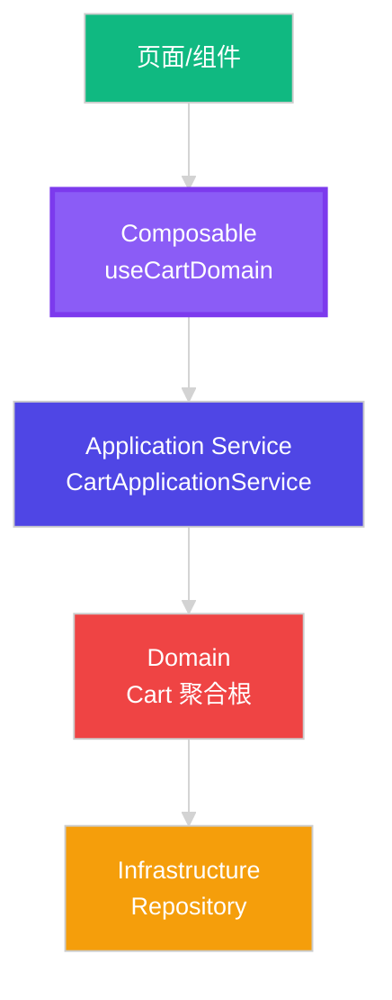
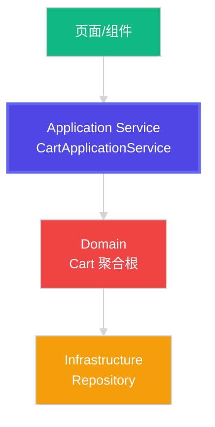
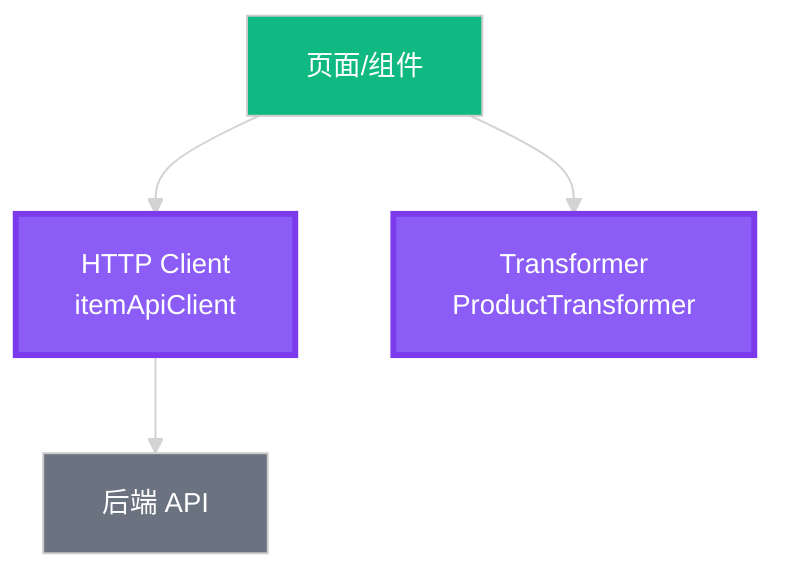
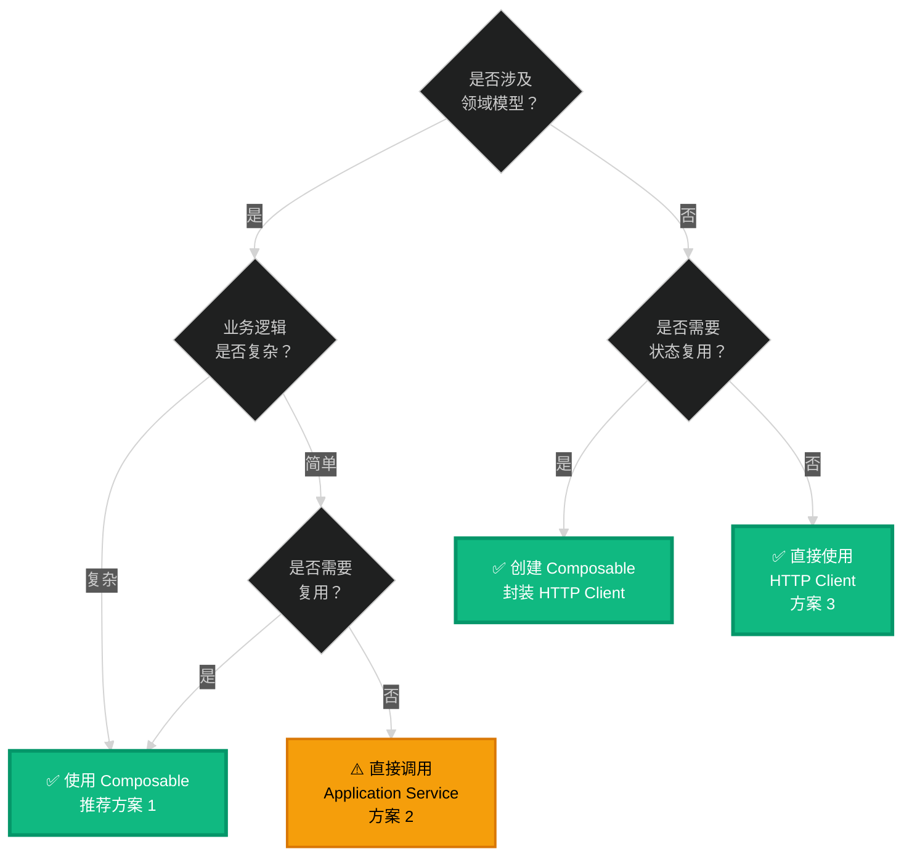

# 表现层访问模式最佳实践

## 📋 核心问题

**页面/UI 组件如何访问业务逻辑？**

有三种主要方案：
1. 页面 → **Composable** → Application Service → Domain
2. 页面 → **Application Service** → Domain
3. 页面 → **HTTP Client + Transformer**（不涉及领域层）

## 🎯 方案对比

### 方案 1: 通过 Composable（推荐 ✅）



**代码示例**：

```vue
<!-- ✅ 推荐：通过 Composable -->
<script setup lang="ts">
import { useCartDomain } from '~/composables/domain/cart/useCartDomain'

// 🎯 优点：获得封装好的响应式状态和方法
const { 
  cartUIData,       // 响应式的 UI 数据
  loading,          // 加载状态
  error,            // 错误信息
  addToCart,        // 添加到购物车
  updateQuantity,   // 更新数量
  removeCartItem,   // 删除商品
  loadCart          // 加载购物车
} = useCartDomain()

onMounted(() => {
  loadCart()  // 自动处理加载状态、错误处理
})
</script>

<template>
  <div>
    <div v-if="loading">加载中...</div>
    <div v-else-if="error">{{ error }}</div>
    <div v-else>
      <!-- 直接使用响应式数据 -->
      <div v-for="item in cartUIData.items" :key="item.id">
        {{ item.name }}
      </div>
      <div>合计：{{ cartUIData.total }}</div>
    </div>
  </div>
</template>
```

**Composable 内部实现**：

```typescript
// app/composables/domain/cart/useCartDomain.ts
import { CartApplicationService } from '~/application/cart/CartApplicationService'
import { CartHttpRepository } from '~/infrastructure/repositories/CartHttpRepository'
import { CartPolicyService } from '~/domain/cart/CartPolicyService'

export function useCartDomain() {
  // 1. 响应式状态
  const cart = ref<Cart | null>(null)
  const loading = ref(false)
  const error = ref<string | null>(null)
  
  // 2. 初始化应用服务（单例）
  const appService = useState('cartAppService', () => {
    const repository = new CartHttpRepository()
    const policyService = new CartPolicyService()
    return new CartApplicationService(repository, policyService)
  })
  
  // 3. 转换为 UI 数据
  const cartUIData = computed(() => {
    if (!cart.value) return { /* 空数据 */ }
    
    return {
      items: CartTransformer.toUIList(cart.value.items),
      total: cart.value.calculateTotal().display,
      // ... 其他 UI 数据
    }
  })
  
  // 4. 业务方法（封装错误处理、加载状态）
  async function addToCart(dto: AddToCartDto) {
    loading.value = true
    error.value = null
    try {
      await appService.value.addToCart(getUserId(), dto)
      await loadCart()
      return { success: true }
    } catch (err: any) {
      error.value = err.message
      return { success: false, error: err.message }
    } finally {
      loading.value = false
    }
  }
  
  return { cartUIData, loading, error, addToCart, /* ... */ }
}
```

**✅ 优点**：
1. **响应式封装**：自动处理响应式状态，页面无需手动管理
2. **错误处理**：统一的错误处理和加载状态管理
3. **代码复用**：多个页面/组件可以共享同一个 composable
4. **关注点分离**：页面只关心 UI，业务逻辑在 composable 中
5. **易于测试**：可以单独测试 composable，页面测试更简单
6. **Vue 生态**：符合 Vue 3 Composition API 的最佳实践

**❌ 缺点**：
1. 多了一层抽象（但带来的好处远大于成本）

**📌 适用场景**：
- ✅ **涉及领域模型的业务逻辑**（如购物车、订单）
- ✅ **需要响应式状态管理**
- ✅ **多个页面/组件需要复用相同逻辑**
- ✅ **需要统一的错误处理和加载状态**

---

### 方案 2: 直接调用 Application Service（可选 ⚠️）



**代码示例**：

```vue
<!-- ⚠️ 可选：直接使用 Application Service -->
<script setup lang="ts">
import { CartApplicationService } from '~/application/cart/CartApplicationService'
import { CartHttpRepository } from '~/infrastructure/repositories/CartHttpRepository'
import { CartPolicyService } from '~/domain/cart/CartPolicyService'
import { CartTransformer } from '~/infrastructure/transformers/cartTransformer'
import type { Cart } from '~/domain/cart/Cart'

// 🎯 需要手动管理状态
const cart = ref<Cart | null>(null)
const loading = ref(false)
const error = ref<string | null>(null)

// 手动创建应用服务
const repository = new CartHttpRepository()
const policyService = new CartPolicyService()
const cartService = new CartApplicationService(repository, policyService)

// 手动计算 UI 数据
const cartUIData = computed(() => {
  if (!cart.value) return { items: [], total: '¥0.00' }
  
  return {
    items: CartTransformer.toUIList(cart.value.items),
    total: cart.value.calculateTotal().display,
  }
})

// 手动实现业务方法
async function addToCart(dto: AddToCartDto) {
  loading.value = true
  error.value = null
  try {
    await cartService.addToCart('current-user', dto)
    await loadCart()
  } catch (err: any) {
    error.value = err.message
  } finally {
    loading.value = false
  }
}

async function loadCart() {
  loading.value = true
  try {
    cart.value = await cartService.getCart('current-user')
  } catch (err: any) {
    error.value = err.message
  } finally {
    loading.value = false
  }
}

onMounted(() => {
  loadCart()
})
</script>

<template>
  <!-- 同上 -->
</template>
```

**✅ 优点**：
1. **少一层抽象**：直接访问应用服务
2. **更明确的控制**：可以精确控制每个步骤

**❌ 缺点**：
1. **重复代码**：每个页面都要写相同的状态管理和错误处理
2. **不易复用**：逻辑散落在各个页面中
3. **维护成本高**：修改逻辑需要改多个页面
4. **测试困难**：每个页面都要测试完整的业务逻辑
5. **不符合 Vue 最佳实践**：违背了 Composition API 的设计理念

**📌 适用场景**：
- ⚠️ **仅在单个页面使用的特殊逻辑**
- ⚠️ **临时功能或原型开发**
- ❌ **不推荐用于生产环境的核心功能**

---

### 方案 3: 直接使用 HTTP Client（简单数据 ✅）



**代码示例**：

```vue
<!-- ✅ 推荐：简单数据获取场景 -->
<script setup lang="ts">
import { itemApiClient } from '~/infrastructure/http/clients/ItemApiClient'
import { ProductTransformer } from '~/infrastructure/transformers/productTransformer'
import type { IProduct } from '~/components/SpProductCard/types'

// 简单的状态管理
const products = ref<IProduct[]>([])
const loading = ref(false)

async function loadProducts(params: IItemListParams) {
  loading.value = true
  try {
    // 1. 获取数据
    const response = await itemApiClient.getItemList(params)
    
    // 2. 转换数据
    if (response?.data?.list) {
      products.value = ProductTransformer.toUIList(response.data.list)
    }
  } catch (err) {
    console.error('加载失败:', err)
  } finally {
    loading.value = false
  }
}
</script>

<template>
  <div>
    <div v-for="product in products" :key="product.itemId">
      {{ product.itemName }}
    </div>
  </div>
</template>
```

**✅ 优点**：
1. **简单直接**：代码简洁，易于理解
2. **快速开发**：适合简单的 CRUD 操作
3. **无需领域模型**：不需要定义复杂的领域对象

**❌ 缺点**：
1. **无业务逻辑**：只能做简单的数据获取和展示
2. **无法复用**：每个页面都要写相似的代码

**📌 适用场景**：
- ✅ **简单的数据列表展示**（商品列表、文章列表）
- ✅ **不涉及复杂业务规则**
- ✅ **仅在单个页面使用**
- ✅ **快速原型开发**

---

## 🎯 最佳实践推荐

### 📊 决策树



### 1️⃣ 购物车场景（复杂业务逻辑）

**✅ 推荐：方案 1 - Composable**

```vue
<script setup lang="ts">
// ✅ 最佳实践
import { useCartDomain } from '~/composables/domain/cart/useCartDomain'

const { cartUIData, addToCart, removeCartItem } = useCartDomain()
</script>
```

**原因**：
- 涉及领域模型（Cart 聚合根）
- 复杂业务规则（库存检查、价格计算、优惠券）
- 需要响应式状态
- 多个页面需要复用

### 2️⃣ 订单管理场景（复杂业务逻辑）

**✅ 推荐：方案 1 - Composable**

```vue
<script setup lang="ts">
// ✅ 最佳实践
import { useOrderDomain } from '~/composables/domain/order/useOrderDomain'

const { orders, createOrder, cancelOrder } = useOrderDomain()
</script>
```

### 3️⃣ 商品列表场景（简单数据展示）

**✅ 推荐：方案 3 - HTTP Client**

```vue
<script setup lang="ts">
// ✅ 简单场景，直接使用
import { itemApiClient } from '~/infrastructure/http/clients/ItemApiClient'
import { ProductTransformer } from '~/infrastructure/transformers/productTransformer'

const products = ref([])

async function loadProducts() {
  const response = await itemApiClient.getItemList(params)
  products.value = ProductTransformer.toUIList(response.data.list)
}
</script>
```

**如果多个页面需要复用，升级为 Composable**：

```typescript
// app/composables/domain/product/useProductList.ts
export function useProductList() {
  const products = ref<IProduct[]>([])
  const loading = ref(false)
  
  async function loadProducts(params: IItemListParams) {
    loading.value = true
    try {
      const response = await itemApiClient.getItemList(params)
      products.value = ProductTransformer.toUIList(response.data.list)
    } finally {
      loading.value = false
    }
  }
  
  return { products, loading, loadProducts }
}
```

### 4️⃣ 用户资料编辑（简单 CRUD）

**✅ 推荐：方案 3 - HTTP Client（如果只有一个页面）**

```vue
<script setup lang="ts">
import { userApiClient } from '~/infrastructure/http/clients/UserApiClient'

async function updateProfile(data) {
  await userApiClient.updateProfile(data)
}
</script>
```

**✅ 推荐：方案 1 - Composable（如果多个页面需要）**

```vue
<script setup lang="ts">
import { useUserProfile } from '~/composables/domain/user/useUserProfile'

const { profile, updateProfile } = useUserProfile()
</script>
```

---

## 📝 规则总结

### ✅ 必须使用 Composable 的场景

| 场景 | 原因 |
|------|------|
| **涉及领域模型** | Cart、Order、Payment 等聚合根 |
| **复杂业务规则** | 多步骤流程、状态机、业务约束 |
| **需要状态复用** | 多个页面/组件需要相同的状态和逻辑 |
| **需要统一错误处理** | 全局的加载状态、错误提示 |

### ✅ 推荐使用 Composable 的场景

| 场景 | 原因 |
|------|------|
| **响应式状态管理** | 自动处理响应式更新 |
| **代码可维护性** | 集中管理，易于修改 |
| **团队协作** | 统一的代码风格和最佳实践 |

### ⚠️ 可以直接使用 HTTP Client 的场景

| 场景 | 原因 |
|------|------|
| **简单数据获取** | 纯展示，无业务逻辑 |
| **单页面使用** | 不需要复用 |
| **快速原型** | 开发速度优先 |

### ❌ 不推荐直接调用 Application Service

**原因**：
- 破坏了封装性
- 重复代码多
- 不符合 Vue 最佳实践
- 维护成本高

---

## 🎯 架构演进建议

### 阶段 1：快速开发（原型阶段）

```vue
<!-- 直接使用 HTTP Client -->
<script setup lang="ts">
const response = await itemApiClient.getItemList(params)
const products = ProductTransformer.toUIList(response.data.list)
</script>
```

### 阶段 2：需求稳定（重构阶段）

```vue
<!-- 提取为 Composable -->
<script setup lang="ts">
const { products, loadProducts } = useProductList()
</script>
```

### 阶段 3：业务复杂（引入领域模型）

```vue
<!-- 完整 DDD 架构 -->
<script setup lang="ts">
const { productDomainData, addToCart } = useProductDomain()
</script>
```

---

## 💡 最终建议

### ✅ 默认使用 Composable

**理由**：
1. **符合 Vue 3 最佳实践**
2. **代码可复用、可维护**
3. **统一的错误处理和加载状态**
4. **易于测试**
5. **未来易于扩展**

### ⚠️ 特殊情况例外

**仅在以下情况直接使用 HTTP Client**：
- 非常简单的数据获取（不超过 10 行代码）
- 确定只在一个地方使用
- 不涉及任何业务逻辑

### ❌ 避免直接调用 Application Service

**除非**：
- 你是在写测试代码
- 你是在写其他 Composable（合理的情况）

---

## 📚 代码示例汇总

### 完整的 Composable 示例

```typescript
// app/composables/domain/cart/useCartDomain.ts
export function useCartDomain() {
  // 1. 状态定义
  const cart = ref<Cart | null>(null)
  const loading = ref(false)
  const error = ref<string | null>(null)
  
  // 2. 应用服务（单例）
  const appService = useState('cartAppService', () => {
    const repository = new CartHttpRepository()
    const policyService = new CartPolicyService()
    return new CartApplicationService(repository, policyService)
  })
  
  // 3. 计算属性（UI 数据）
  const cartUIData = computed(() => {
    if (!cart.value) return defaultCartUIData
    return transformToUIData(cart.value)
  })
  
  // 4. 业务方法
  async function addToCart(dto: AddToCartDto) {
    loading.value = true
    error.value = null
    try {
      await appService.value.addToCart(getUserId(), dto)
      await loadCart()
      return { success: true }
    } catch (err: any) {
      error.value = err.message
      return { success: false, error: err.message }
    } finally {
      loading.value = false
    }
  }
  
  // 5. 导出
  return {
    // 状态
    cartUIData,
    loading,
    error,
    
    // 方法
    addToCart,
    removeCartItem,
    updateQuantity,
    loadCart,
  }
}
```

### 页面使用示例

```vue
<!-- app/pages/cart/index.vue -->
<script setup lang="ts">
import { useCartDomain } from '~/composables/domain/cart/useCartDomain'

// 简单、清晰、易维护
const { 
  cartUIData, 
  loading, 
  addToCart, 
  removeCartItem 
} = useCartDomain()

onMounted(() => {
  loadCart()
})
</script>

<template>
  <div v-if="loading">加载中...</div>
  <CartList v-else :items="cartUIData.items" />
</template>
```

---

## 🎉 结论

**推荐架构**：

```
页面/组件
   ↓
Composable (useCartDomain)  ← 推荐的访问方式
   ↓
Application Service (CartApplicationService)
   ↓
Domain (Cart 聚合根)
   ↓
Infrastructure (Repository, HTTP Client, Transformer)
```

**核心原则**：
1. ✅ **优先使用 Composable**（90% 的场景）
2. ✅ **简单数据可直接用 HTTP Client**（10% 的场景）
3. ❌ **避免直接调用 Application Service**（除非在 Composable 内部）

这样既符合 DDD 架构，又符合 Vue 3 的最佳实践！🚀


