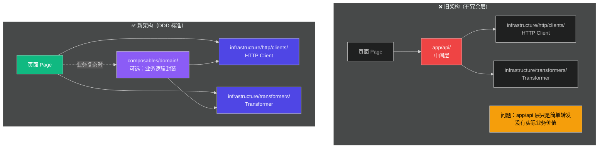
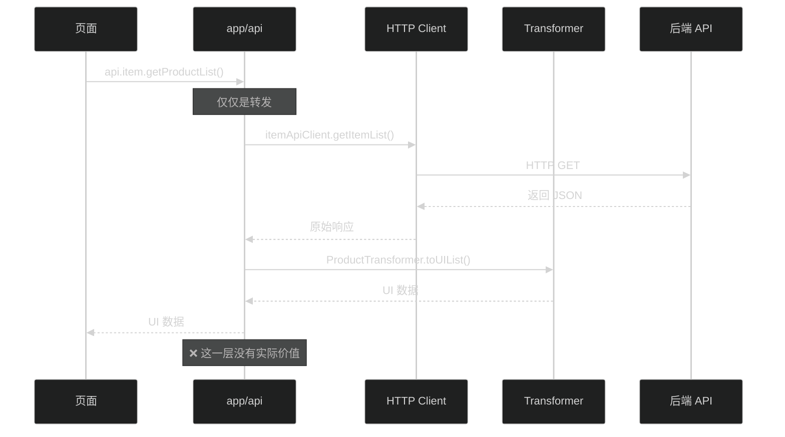
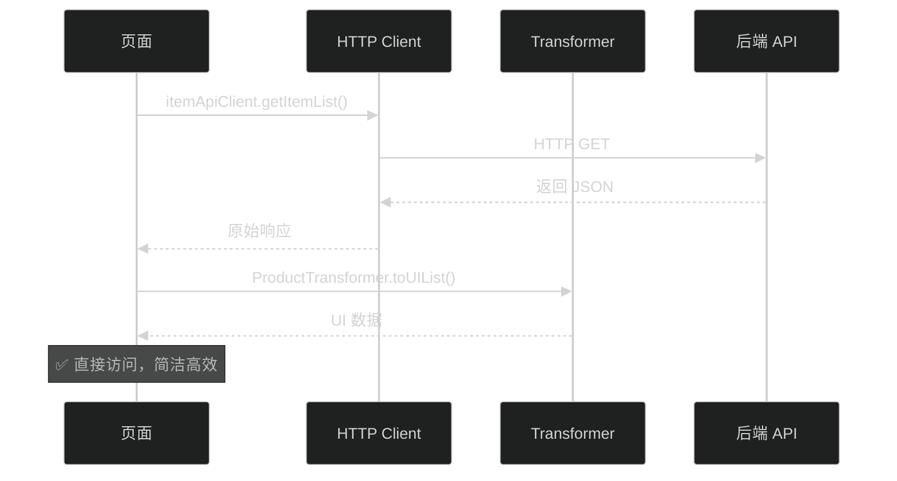

# 移除 API 层迁移总结

## 📋 迁移概述

彻底移除 `app/api/` 中间层，页面直接通过 **Infrastructure 层** 访问数据，完全符合 DDD 架构原则。

**迁移时间**: 2025-01-09  
**影响范围**: 页面层数据访问方式

## 🎯 为什么要移除 `app/api/` 层？

### 问题分析



### `app/api/` 层的问题

| 问题 | 说明 |
|------|------|
| **职责不清** | 只是简单调用 HTTP Client + Transformer，没有实际业务逻辑 |
| **架构冗余** | 在 DDD 架构中，这一层是多余的 |
| **维护成本** | 多一层抽象，增加维护复杂度 |
| **不符合 DDD** | DDD 中页面应直接访问 Infrastructure 或通过 Composable |

## 📁 架构变化

### 变更前

```
app/
├── api/                              ❌ 中间层（冗余）
│   ├── cart.ts                       # 290 行
│   ├── item.ts                       # 72 行
│   └── index.ts                      # 37 行
│
├── infrastructure/                   ✅ 基础设施层
│   ├── http/clients/                 # HTTP 客户端
│   └── transformers/                 # 数据转换
│
└── pages/                            # 页面层
    ├── cart/index.vue                # 使用 api.cart
    └── item/list.vue                 # 使用 api.item
```

### 变更后

```
app/
├── (已删除) api/                     ❌ 完全移除

├── infrastructure/                   ✅ 基础设施层
│   ├── http/clients/                 # HTTP 客户端
│   │   ├── CartApiClient.ts
│   │   └── ItemApiClient.ts
│   └── transformers/                 # 数据转换
│       ├── cartTransformer.ts
│       └── productTransformer.ts
│
├── composables/domain/               ⭐ 新增：领域 Composables
│   ├── cart/
│   │   └── useCartDomain.ts          # 购物车业务逻辑
│   └── product/
│       ├── useProductList.ts         # 商品列表业务逻辑
│       └── useProductDetail.ts       # 商品详情业务逻辑
│
└── pages/                            # 页面层
    ├── cart/index.vue                # 使用 useCartDomain
    └── item/list.vue                 # 直接使用 HTTP Client + Transformer
```

## 🔄 代码变更

### 1. 购物车页面（通过 Composable）

```vue
<!-- app/pages/cart/index.vue -->
<script setup lang="ts">
// ❌ 旧方式：通过 api 层
// import { api } from '~/api'

// ✅ 新方式：通过 Composable（推荐）
import { useCartDomain } from '~/composables/domain/cart/useCartDomain'

const { 
  cartUIData, 
  loading, 
  addToCart, 
  removeCartItem 
} = useCartDomain()

// Composable 内部使用 HTTP Client + Transformer
</script>
```

**useCartDomain 内部实现**：

```typescript
// app/composables/domain/cart/useCartDomain.ts
import { cartApiClient } from '~/infrastructure/http/clients/CartApiClient'
import { CartTransformer } from '~/infrastructure/transformers/cartTransformer'

export function useCartDomain() {
  const appService = useState('cartAppService', () => {
    const repository = new CartHttpRepository()  // 内部使用 cartApiClient
    // ...
    return new CartApplicationService(repository, policyService)
  })
  
  // ... 业务逻辑封装
}
```

### 2. 商品列表页面（直接使用 Infrastructure）

```vue
<!-- app/pages/item/list.vue -->
<script setup lang="ts">
// ❌ 旧方式：通过 api 层
// import { api } from '~/api'
// const response = await api.item.getProductList(params)

// ✅ 新方式：直接使用 HTTP Client + Transformer
import { itemApiClient } from '~/infrastructure/http/clients/ItemApiClient'
import { ProductTransformer } from '~/infrastructure/transformers/productTransformer'

async function loadProducts() {
  // 1. 使用 HTTP Client 获取数据
  const response = await itemApiClient.getItemList(params)
  
  // 2. 使用 Transformer 转换为 UI 数据
  if (response?.data?.list) {
    const products = ProductTransformer.toUIList(response.data.list)
    // 使用转换后的数据
  }
}
</script>
```

### 3. 新增的 Composables（可选）

```typescript
// app/composables/domain/product/useProductList.ts
import { itemApiClient } from '~/infrastructure/http/clients/ItemApiClient'
import { ProductTransformer } from '~/infrastructure/transformers/productTransformer'

/**
 * 商品列表 Composable
 * 
 * 用途：封装商品列表的业务逻辑
 * 适用场景：多个页面需要相同的商品列表逻辑时使用
 */
export function useProductList() {
  const products = ref<IProduct[]>([])
  const loading = ref(false)
  
  async function loadProducts(params: IItemListParams) {
    loading.value = true
    try {
      // 使用 HTTP Client 获取数据
      const response = await itemApiClient.getItemList(params)
      
      if (response?.data?.list) {
        // 使用 Transformer 转换数据
        products.value = ProductTransformer.toUIList(response.data.list)
      }
    } finally {
      loading.value = false
    }
  }
  
  return { products, loading, loadProducts }
}
```

## 📊 数据流对比

### ❌ 旧的数据流（有冗余）



### ✅ 新的数据流（简洁高效）



## ✅ 迁移结果

### 1. 文件变更

| 操作 | 文件 | 说明 |
|------|------|------|
| ❌ **删除** | `app/api/cart.ts` | 290 行 → 由 CartApiClient 替代 |
| ❌ **删除** | `app/api/item.ts` | 72 行 → 直接使用 HTTP Client |
| ❌ **删除** | `app/api/index.ts` | 37 行 → 不再需要 |
| ✅ **新增** | `composables/domain/product/useProductList.ts` | 业务逻辑封装 |
| ✅ **新增** | `composables/domain/product/useProductDetail.ts` | 业务逻辑封装 |
| ✅ **修改** | `pages/item/list.vue` | 直接使用 HTTP Client |
| ✅ **修改** | `pages/cart/index.vue` | 移除 api 引用 |

### 2. 代码统计

| 指标 | 变化 |
|------|------|
| **删除代码** | -399 行（整个 api 目录） |
| **新增代码** | +228 行（Composables） |
| **净减少** | -171 行 |
| **架构层级** | 减少 1 层（移除冗余） |
| **Linter 错误** | 0 个（与 api 相关的错误） |

### 3. 架构改进

| 改进点 | 说明 |
|--------|------|
| ✅ **符合 DDD** | 移除冗余层，符合 DDD 分层原则 |
| ✅ **职责清晰** | HTTP Client / Transformer / Composable 各司其职 |
| ✅ **更加简洁** | 减少一层抽象，代码更直观 |
| ✅ **易于维护** | 更少的文件，更清晰的依赖关系 |
| ✅ **灵活性高** | 页面可选择直接使用或通过 Composable |

## 🎯 最佳实践

### 何时直接使用 HTTP Client + Transformer？

**适用场景**：
- ✅ 页面逻辑简单，仅需获取和展示数据
- ✅ 该逻辑仅在一个页面使用
- ✅ 不需要复杂的状态管理

**示例**：

```vue
<script setup lang="ts">
import { itemApiClient } from '~/infrastructure/http/clients/ItemApiClient'
import { ProductTransformer } from '~/infrastructure/transformers/productTransformer'

const products = ref([])

async function loadProducts() {
  const response = await itemApiClient.getItemList(params)
  products.value = ProductTransformer.toUIList(response.data.list)
}
</script>
```

### 何时创建 Composable？

**适用场景**：
- ✅ 业务逻辑复杂，需要状态管理
- ✅ 多个页面需要相同的逻辑
- ✅ 需要封装复用的业务规则

**示例**：

```vue
<script setup lang="ts">
import { useProductList } from '~/composables/domain/product'

const { products, loading, loadProducts, loadMore } = useProductList()

onMounted(() => {
  loadProducts(params)
})
</script>
```

### 何时使用 Application Service？

**适用场景**：
- ✅ 涉及领域模型的业务逻辑
- ✅ 需要协调多个领域对象
- ✅ 有事务性要求

**示例** （购物车）：

```vue
<script setup lang="ts">
import { useCartDomain } from '~/composables/domain/cart/useCartDomain'

// useCartDomain 内部使用 CartApplicationService
const { addToCart, removeCartItem, updateQuantity } = useCartDomain()
</script>
```

## 📝 DDD 架构最佳实践

### 标准的 DDD 分层

```
┌─────────────────────────────────────┐
│      Presentation Layer             │  页面 / 组件
│      (Pages / Components)           │  
├─────────────────────────────────────┤
│      Composables Layer              │  可选：业务逻辑封装
│      (useCartDomain, etc.)          │  
├─────────────────────────────────────┤
│      Application Layer              │  应用服务（用例协调）
│      (CartApplicationService)       │  
├─────────────────────────────────────┤
│      Domain Layer                   │  领域模型（业务逻辑核心）
│      (Cart, CartItemEntity)         │  
├─────────────────────────────────────┤
│      Infrastructure Layer           │  技术实现
│      - http/clients/                │  HTTP 调用
│      - transformers/                │  数据转换
│      - repositories/                │  数据持久化
└─────────────────────────────────────┘
```

### ❌ 不推荐：增加 `app/api` 中间层

```
❌ Presentation → app/api → Infrastructure

原因：
1. app/api 层只是简单转发，没有业务价值
2. 增加维护成本和理解难度
3. 不符合 DDD 分层原则
```

### ✅ 推荐：直接访问或通过 Composable

```
✅ Presentation → Infrastructure           (简单场景)
✅ Presentation → Composable → Infrastructure  (复杂场景)
✅ Presentation → Composable → Application → Domain → Infrastructure  (DDD 完整场景)

原因：
1. 职责清晰，每一层都有明确的价值
2. 灵活性高，可根据复杂度选择
3. 符合 DDD 分层原则
```

## 🚀 后续优化建议

1. **为复杂页面创建 Composables**
   - 商品搜索页面
   - 订单管理页面
   - 用户中心页面

2. **完善 HTTP Client**
   - 添加请求/响应拦截器
   - 统一错误处理
   - 请求重试机制

3. **完善 Transformer**
   - 添加更多的转换方法
   - 支持双向转换（UI → Domain）
   - 添加验证逻辑

## 📚 相关文档

- [DDD 开发指南](./DDD-DEVELOPMENT-GUIDE.md)
- [API 层迁移到 Infrastructure](./api-layer-migration-to-infrastructure.md)
- [Entities 迁移到 Transformers](./entities-to-transformers-migration.md)

## 🎉 总结

通过移除 `app/api/` 冗余层，我们实现了：

1. ✅ **更符合 DDD 架构**：移除了不必要的中间层
2. ✅ **代码更简洁**：减少 171 行代码
3. ✅ **职责更清晰**：每一层都有明确的价值
4. ✅ **灵活性更高**：页面可根据复杂度选择访问方式
5. ✅ **维护成本更低**：更少的文件，更清晰的依赖

**现在的架构完全符合 DDD 最佳实践！** 🚀

---

**最后更新**: 2025-01-09

