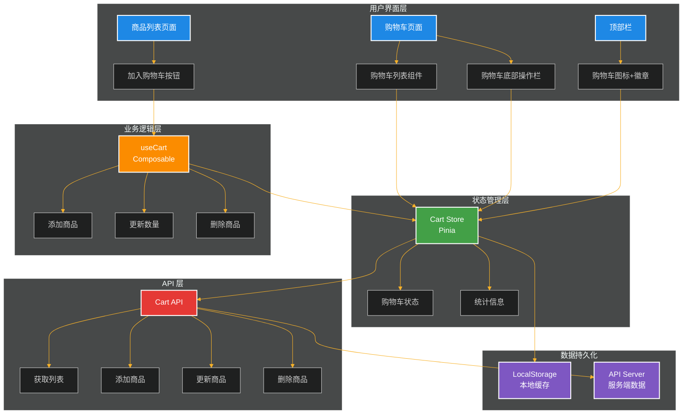
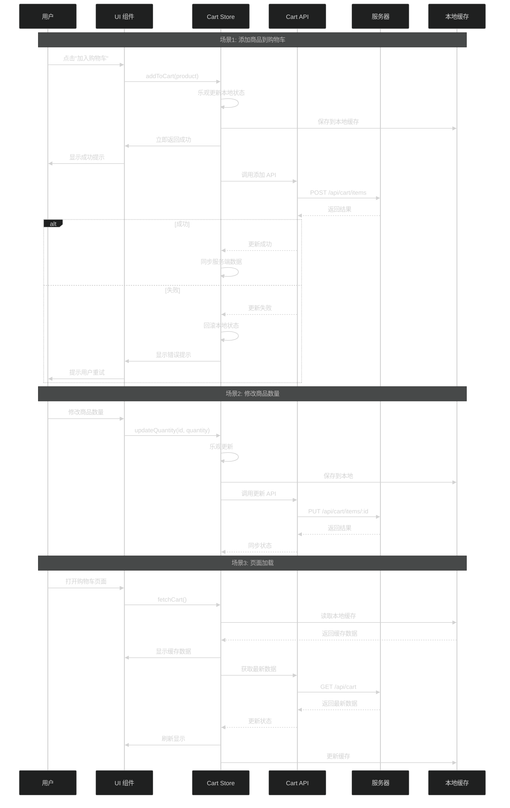
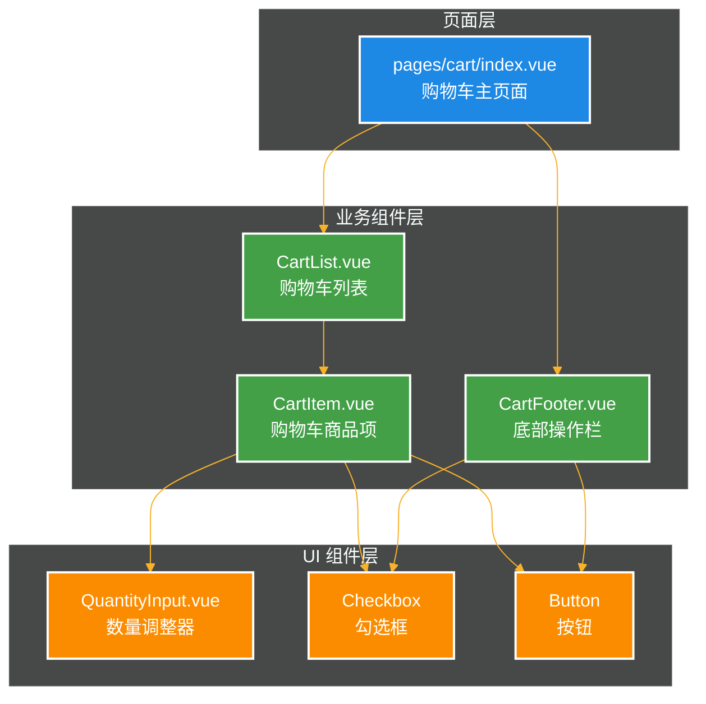

# 购物车功能提案总结

## 概述

本文档总结了 ECSHOPX Web 购物车功能的 OpenSpec 提案，包括功能需求、架构设计、实施计划等。

## 提案状态

- **提案 ID**: add-shopping-cart
- **状态**: ✅ 已验证通过
- **创建时间**: 2025-10-31
- **影响规格**: shopping-cart (新增)

## UI 设计参考

购物车页面采用表格布局，参考设计包含以下核心元素:

### 页面结构

```
┌─────────────────────────────────────────────────────────────┐
│                     购物车页面标题                            │
├────┬──────────────────┬────────┬────────┬────────┬─────────┤
│ □  │    商品信息      │  单价  │  数量  │  合计  │  操作   │ ← 表头
├────┼──────────────────┼────────┼────────┼────────┼─────────┤
│ ☑  │ [图] 商品名称    │ ¥800  │ [-][1][+]│ ¥800  │删除|收藏│ ← 商品行
│    │     规格描述     │ ¥1200 │        │        │         │
├────┼──────────────────┼────────┼────────┼────────┼─────────┤
│ ☑  │ [图] 商品名称    │¥4900  │ [-][1][+]│¥4900  │删除|收藏│
│    │     规格描述     │ ¥5000 │        │        │         │
└────┴──────────────────┴────────┴────────┴────────┴─────────┘
┌─────────────────────────────────────────────────────────────┐
│ ☑全选  删除  收藏  |  已选商品 2 件  合计: ¥5700.00  [结算] │ ← 底部操作栏
└─────────────────────────────────────────────────────────────┘
```

### 关键 UI 元素

1. **表头**: 灰色背景，包含商品信息、单价、数量、合计、操作
2. **商品行**:
   - 勾选框用于选择商品
   - 商品图片（左侧）
   - 商品名称和规格
   - 原价（删除线）和现价
   - 数量调整器（-、输入框、+）
   - 商品小计
   - 操作按钮（删除、收藏）
3. **底部操作栏**:
   - 全选勾选框
   - 批量操作（删除、收藏）
   - 已选商品统计
   - 合计金额（红色高亮）
   - 结算按钮（主色调）

## 架构设计

### 系统架构图



### 数据流图



### 组件结构



## API 对接方式

### API 端点定义

基于 Apifox MCP 服务器的购物车 API 规范:

| 方法   | 路径                | 说明             | 请求体                  | 响应              |
| ------ | ------------------- | ---------------- | ----------------------- | ----------------- |
| GET    | /api/cart           | 获取购物车列表   | -                       | ICartListResponse |
| POST   | /api/cart/items     | 添加商品到购物车 | IAddCartRequest         | IAddCartResponse  |
| PUT    | /api/cart/items/:id | 更新购物车商品   | IUpdateCartRequest      | void              |
| DELETE | /api/cart/items/:id | 删除单个商品     | -                       | void              |
| DELETE | /api/cart/items     | 批量删除商品     | IBatchRemoveCartRequest | void              |
| DELETE | /api/cart           | 清空购物车       | -                       | void              |

### 数据类型定义

已在 `app/types/api/cart.ts` 中完整定义:

- `ICartItem` - 购物车商品项
- `ICartListResponse` - 购物车列表响应
- `IAddCartRequest` - 添加商品请求
- `IUpdateCartRequest` - 更新商品请求
- `IBatchRemoveCartRequest` - 批量删除请求

## 实施计划

### 任务分解

总计 **11 个主要模块**, **185+ 个子任务**:

1. **API 定义和类型创建** (6 个任务)
   - 从 Apifox MCP 获取 API 定义
   - 创建类型定义和 API 调用函数

2. **状态管理** (7 个任务)
   - 更新 Cart Store 集成真实 API
   - 实现数据持久化
   - 完善统计计算

3. **组合式函数** (4 个任务)
   - 创建 useCart composable
   - 实现购物车操作逻辑

4. **UI 组件实现** (23 个任务)
   - 数量调整器组件
   - 购物车商品项组件
   - 购物车列表组件
   - 底部操作栏组件

5. **页面实现** (10 个任务)
   - 购物车主页面
   - 交互逻辑
   - SEO 优化

6. **现有组件集成** (8 个任务)
   - 商品卡片添加购物车按钮
   - 顶部栏显示购物车徽章

7. **样式和交互优化** (9 个任务)
   - 页面样式
   - 动画效果

8. **错误处理和边界情况** (12 个任务)
   - API 错误处理
   - 数据验证
   - 边界情况

9. **性能优化** (8 个任务)
   - 列表渲染优化
   - 状态更新优化
   - 防抖节流

10. **测试和验证** (14 个任务)
    - 单元测试
    - 组件测试
    - 集成测试
    - 用户体验测试

11. **文档和收尾** (9 个任务)
    - 更新项目文档
    - 代码审查
    - 提交归档

### 预估时间线

- **阶段 1: 基础搭建** (1-2 天)
  - API 定义和类型
  - Store 更新
  - Composable 创建

- **阶段 2: UI 实现** (2-3 天)
  - 所有组件开发
  - 页面布局

- **阶段 3: 功能集成** (1-2 天)
  - 现有组件集成
  - 交互逻辑

- **阶段 4: 优化完善** (1-2 天)
  - 样式和动画
  - 性能优化
  - 错误处理

- **阶段 5: 测试验收** (1-2 天)
  - 各类测试
  - Bug 修复

**总预估**: 6-11 个工作日

## 关键技术决策

### 1. 状态管理架构

- ✅ 使用 Pinia store 作为单一数据源
- ✅ 支持 SSR 和客户端状态同步
- ✅ TypeScript 类型安全

### 2. 数据同步策略

- ✅ 乐观更新 + 错误回滚
- ✅ 服务端优先，本地缓存加速
- ✅ 页面激活时自动刷新

### 3. UI 实现方式

- ✅ 表格布局展示购物车
- ✅ 使用 Tailwind CSS，禁止自定义 CSS
- ✅ 组件化拆分，提高复用性

### 4. API 对接方式

- ✅ 通过 Apifox MCP 管理 API 定义
- ✅ 统一的 HTTP 客户端
- ✅ 完整的类型定义

### 5. 性能优化策略

- ✅ 虚拟滚动处理大量商品
- ✅ 防抖节流优化操作
- ✅ 使用 shallowRef 优化性能

## 风险与缓解

| 风险           | 影响       | 缓解措施                          |
| -------------- | ---------- | --------------------------------- |
| API 接口未定义 | 阻塞开发   | 使用 Mock 数据，先定义前端类型    |
| 数据同步冲突   | 数据不一致 | 乐观更新 + 错误回滚，页面激活刷新 |
| 性能问题       | 用户体验差 | 虚拟滚动，防抖节流，状态优化      |
| 浏览器兼容性   | 功能异常   | 充分测试，降级方案                |

## 下一步行动

1. ✅ **完成 OpenSpec 提案** - 已完成
2. ⏳ **等待提案审批** - 待进行
3. ⏳ **开始实施** - 按照 tasks.md 顺序执行
4. ⏳ **持续迭代** - 根据用户反馈优化

## 相关文档

- [提案文档](../openspec/changes/add-shopping-cart/proposal.md)
- [规格说明](../openspec/changes/add-shopping-cart/specs/shopping-cart/spec.md)
- [设计文档](../openspec/changes/add-shopping-cart/design.md)
- [任务清单](../openspec/changes/add-shopping-cart/tasks.md)
- [API 类型定义](../app/types/api/cart.ts)

## 参考资料

- [Nuxt 4 文档](https://nuxt.com/)
- [Pinia 文档](https://pinia.vuejs.org/)
- [Tailwind CSS 文档](https://tailwindcss.com/)
- [OpenSpec 规范](../openspec/AGENTS.md)

---

**提案创建时间**: 2025-10-31  
**最后更新时间**: 2025-10-31  
**当前状态**: ✅ 已验证，等待审批
